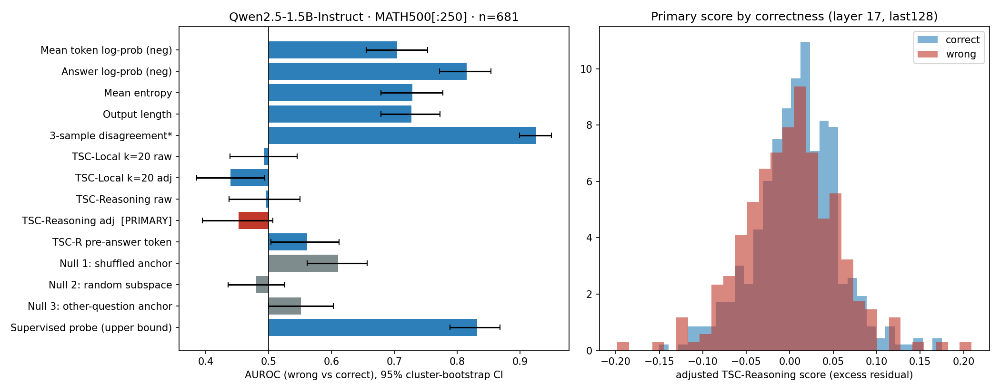

# Tangent-Space Consistency (TSC): a pilot study

**Question:** can a simple geometric score on an LLM's hidden states tell us when the model's math answer is wrong, without using any labels?

**Short answer from this pilot:** no. On 250 MATH500 questions with Qwen2.5-1.5B-Instruct, the TSC score did no better than chance (AUROC 0.45). Simple baselines, such as the model's own token probabilities, did much better.

This repo has the code, the raw outputs and the full results of that pilot.

---

## Contents

1. [The idea](#1-the-idea)
2. [What I did](#2-what-i-did)
3. [Results](#3-results)
4. [What the results mean](#4-what-the-results-mean)
5. [Limitations](#5-limitations)
6. [How to run it](#6-how-to-run-it)
7. [Repo layout](#7-repo-layout)

---

## 1. The idea

When a language model writes a step-by-step solution, each token has a hidden state (a long vector inside the model).

The idea behind TSC:

- The hidden states of the reasoning steps lie close to a small, "flat" region (a low-dimensional subspace).
- If the final answer follows from that reasoning, its hidden states should also lie close to that region.
- If the answer is wrong (a "hallucination"), its hidden states might point away from that region.

So the TSC score works like this:

1. Take the hidden states of the reasoning tokens before the answer. This set is called the **anchor**.
2. Find the main directions of these states with SVD. Keep enough directions to explain 90% of the variance.
3. For each answer token, measure how much of its hidden state lies **outside** those directions. This is the **relative residual**, a number from 0 to 1.
4. Average over the answer tokens. A higher score means "more likely wrong".

The first version of the plan is in [docs/research_proposal.pdf](docs/research_proposal.pdf). The pilot below uses a different, smaller setup (see [Limitations](#5-limitations)).

---

## 2. What I did

### Setup

| Item | Value |
|---|---|
| Model | `Qwen/Qwen2.5-1.5B-Instruct` (28 layers), float16 |
| Data | MATH500, first 250 rows of my CSV copy |
| Answers per question | 1 greedy + 2 sampled (temperature 0.7, top-p 0.95) = 750 answers |
| Max answer length | 1024 new tokens |
| Prompt | "Please reason step by step, and put your final answer within \boxed{}." |
| Grading | Last `\boxed{...}` in the answer, checked against the gold answer with [math-verify](https://github.com/huggingface/Math-Verify) (plus a string-match fallback) |
| Hardware | Kaggle, 2 × NVIDIA T4 |

The questions and the gold answers were kept apart. The model only saw the questions. The gold answers were used only after generation, for grading.

### Which answers were analysed

An answer was kept if it had a `\boxed{}` answer and at least 16 reasoning tokens before that answer. **681 of 750** answers passed this filter. Of these, **430 were correct and 251 were wrong**.

| Answer type | Kept | Correct | Accuracy (on kept answers) |
|---|---|---|---|
| Greedy | 226 | 149 | 65.9% |
| Sample 1 | 225 | 143 | 63.6% |
| Sample 2 | 230 | 138 | 60.0% |

### How the TSC score was computed

- **Layers:** relative depths 0.4, 0.6 and 0.8, which are layers 11, 17 and 22.
- **Anchors:** all reasoning tokens, or only the last 64, 128 or 256 reasoning tokens.
- **Standardisation:** each hidden dimension was centred with its median and scaled with its MAD, then clipped to ±10. The statistics came from the *other* half of the questions (two folds split by question), so no answer was used to scale itself.
- **Raw score:** the mean relative residual over the answer tokens.
- **Adjusted score:** the residual can depend on simple things like token type or position. To remove that, a small gradient-boosting model predicted the residual from token surprisal, entropy, position, distance from the anchor centre and token type. The adjusted score is the residual minus this prediction. This step uses **no correctness labels** and is cross-fitted across the two folds.
- **TSC-Local:** a second version that uses only the 20 tokens just before each token as the anchor.

**Primary score (chosen before looking at the labels):** adjusted TSC-Reasoning, layer 17, anchor = last 128 reasoning tokens.

### What TSC was compared against

- **Baselines:** negative mean token log-prob, negative answer-token log-prob, mean entropy, output length, and disagreement between the 3 answers to the same question.
- **Null versions of TSC.** These check whether the *specific* reasoning subspace matters:
  1. *Shuffled anchor:* the same number of states, picked at random from all earlier tokens.
  2. *Random subspace:* random directions of the same size.
  3. *Other-question anchor:* the anchor from a different question is used to score this answer.
- **Supervised probe (upper bound):** logistic regression on the mean answer hidden state, trained *with* labels (out-of-fold by question). It shows how much signal the hidden states carry when labels are allowed.

### Statistics

- **AUROC** of "wrong vs correct" for each score (0.5 = chance).
- **95% confidence intervals** from 2,000 bootstrap resamples. Whole questions are resampled, so answers to the same question stay together.
- **Within-question AUROC:** compares wrong and correct answers to the *same* question only. This removes the effect of question difficulty (129 such pairs).

---

## 3. Results



### Main table (layer 17, anchor last 128, n = 681, 251 wrong)

Higher score = predicted wrong. AUROC 0.5 = chance.

| Detector | AUROC | 95% CI | AUPRC | TPR @ 5% FPR | Within-question AUROC |
|---|---|---|---|---|---|
| Mean token log-prob (neg) | 0.705 | 0.655 – 0.753 | 0.605 | 0.243 | 0.597 |
| Answer log-prob (neg) | 0.815 | 0.772 – 0.853 | 0.699 | 0.259 | 0.651 |
| Mean entropy | 0.729 | 0.679 – 0.777 | 0.625 | 0.215 | 0.612 |
| Output length | 0.727 | 0.678 – 0.773 | 0.614 | 0.215 | 0.426 |
| 3-sample disagreement\* | 0.926 | 0.899 – 0.950 | 0.824 | 0.594 | 0.771 |
| TSC-Local k=20, raw | 0.492 | 0.438 – 0.545 | 0.375 | 0.040 | 0.519 |
| TSC-Local k=20, adjusted | 0.439 | 0.386 – 0.493 | 0.333 | 0.024 | 0.481 |
| TSC-Reasoning, raw | 0.496 | 0.437 – 0.550 | 0.400 | 0.076 | 0.504 |
| **TSC-Reasoning, adjusted (primary)** | **0.452** | **0.395 – 0.507** | 0.359 | 0.048 | 0.496 |
| TSC-Reasoning, token before the answer | 0.561 | 0.504 – 0.612 | 0.461 | 0.143 | 0.504 |
| Null 1: shuffled anchor | 0.610 | 0.561 – 0.656 | 0.460 | 0.104 | 0.457 |
| Null 2: random subspace | 0.480 | 0.436 – 0.526 | 0.364 | 0.052 | 0.527 |
| Null 3: other-question anchor | 0.552 | 0.500 – 0.603 | 0.430 | 0.104 | 0.512 |
| Supervised probe (uses labels) | 0.832 | 0.788 – 0.868 | 0.761 | 0.355 | 0.667 |

\* Disagreement needs 2 extra generations per question, so it costs more than the other scores. Only 3 answers per question were available, which is fewer than such methods usually use.

### Hypothesis checks

| Check | Result |
|---|---|
| H1: adjusted TSC minus mean log-prob (AUROC) | −0.253 (CI −0.328 to −0.179) |
| H1: raw TSC minus mean log-prob (AUROC) | −0.209 (CI −0.284 to −0.137) |
| H2: how much of the gain survives the adjustment | not defined (there was no gain to begin with) |
| H3: raw TSC minus shuffled-anchor null | −0.115 (CI −0.168 to −0.063) |
| H3: raw TSC minus random-subspace null | +0.015 (CI −0.060 to +0.085) |
| H3: raw TSC minus other-question null | −0.056 (CI −0.133 to +0.020) |
| H4: correct & changed vs correct & unchanged (adjusted TSC) | 0.467 (CI 0.345 to 0.586) |

H4 checks that the score does not simply react to "the sampled answer differs from the greedy one". Here, "changed" means a sampled answer differs from the greedy answer.

### Go / no-go rule (set before the run)

| Criterion | Pass? |
|---|---|
| G1: adjusted TSC beats mean log-prob by at least 0.03 AUROC | ❌ |
| G2a: TSC beats the shuffled-anchor null (CI above 0) | ❌ |
| G2b: TSC beats the other-question null (CI above 0) | ❌ |
| G3: TSC does not just detect "answer changed" (AUROC ≤ 0.60) | ✅ |

**Decision: NO-GO.**

### Exploratory sweep (not used for the decision)

AUROC of TSC-Reasoning for every layer and anchor. "max" means the maximum over answer tokens instead of the mean.

| Layer | Anchor | Raw | Raw (max) | Adjusted | Adjusted (max) | Median rank |
|---|---|---|---|---|---|---|
| 11 | all | 0.384 | 0.496 | 0.409 | 0.495 | 125 |
| 11 | last 64 | 0.497 | 0.592 | 0.459 | 0.529 | 33 |
| 11 | last 128 | 0.482 | 0.583 | 0.456 | 0.531 | 53 |
| 11 | last 256 | 0.466 | 0.570 | 0.449 | 0.537 | 83 |
| 17 | all | 0.367 | 0.446 | 0.397 | 0.459 | 144 |
| 17 | last 64 | 0.505 | 0.583 | 0.452 | 0.521 | 34 |
| 17 | last 128 | 0.496 | 0.569 | 0.452 | 0.518 | 57 |
| 17 | last 256 | 0.480 | 0.559 | 0.443 | 0.513 | 93 |
| 22 | all | 0.401 | 0.482 | 0.419 | 0.458 | 134 |
| 22 | last 64 | 0.472 | 0.569 | 0.439 | 0.490 | 34 |
| 22 | last 128 | 0.462 | 0.567 | 0.431 | 0.482 | 56 |
| 22 | last 256 | 0.461 | 0.568 | 0.426 | 0.486 | 88 |

The best value in the sweep (0.592) is still well below the simple baselines. It was also picked after seeing the results, so I do not treat it as a finding.

---

## 4. What the results mean

In plain words, for this model and this data:

1. **The TSC score did not detect wrong answers.** The primary score had AUROC 0.452, and its confidence interval includes 0.5 (chance). The raw score was 0.496.
2. **Simple baselines did much better.** The answer's own log-prob reached 0.815, and disagreement between 3 answers reached 0.926.
3. **The hidden states do contain the signal.** A supervised probe on the same hidden states reached 0.832. So the information is there, but this unsupervised geometric score does not pick it up.
4. **The reasoning subspace did not matter.** TSC with the real anchor did not beat the null versions. The shuffled-anchor null even scored higher (0.610). Any small signal in the residual is likely not about the reasoning-specific geometry the idea depends on.
5. **The pre-set go/no-go rule says NO-GO.** 3 of the 4 criteria failed.

---

## 5. Limitations

- **One small model and one dataset.** Only Qwen2.5-1.5B-Instruct on 250 MATH500 questions was tested. The results may differ for other models, sizes or tasks.
- **Different from the original plan.** The proposal in `docs/` planned Llama-3-8B on TruthfulQA and GSM8K. This pilot is a smaller, cheaper first test.
- **Small sample.** 681 answers from 245 questions give fairly wide confidence intervals (about ±0.05 AUROC).
- **Only 3 answers per question.** This limits the disagreement baseline and the within-question comparison (129 pairs).
- **Automatic grading.** Answers are checked by `math-verify` and string matching, which can make mistakes on unusual answer formats.
- **69 answers were excluded** (no `\boxed{}` answer, or too little reasoning before the answer). The results only describe the 681 answers that were kept.
- **Question order.** "First 250 rows" refers to my CSV copy of MATH500, which is not in the same order as the HuggingFace `HuggingFaceH4/MATH-500` release.

---

## 6. How to run it

Everything is in one notebook: [tsc_pilot.ipynb](tsc_pilot.ipynb).

### On Kaggle (how the pilot was run)

1. Upload the notebook to Kaggle.
2. Settings → Accelerator = **GPU T4 x2**, Internet = **ON**.
3. Add your MATH500 CSV as a dataset, and set `CSV_PATH` in the configuration cell to its path.
4. **Run All.**

On 2 × T4, generation and both scoring passes run on both GPUs. The notebook also works with one GPU, just more slowly.

Answers are cached in `OUT_DIR`. If the run stops halfway, run it again and only the missing answers are generated.

### Elsewhere

```bash
pip install -r requirements.txt
```

Then open the notebook, set `CSV_PATH`, and run all cells. You need a CUDA GPU for generation.

### Data format

A CSV with two columns:

| question | answer |
|---|---|
| What is $1+1$? | 2 |

The notebook uses the first `N_QUESTIONS` rows (250 by default).

For example, to build such a file from the public MATH-500 release:

```python
import pandas as pd
url = "https://huggingface.co/datasets/HuggingFaceH4/MATH-500/resolve/main/test.jsonl"
df = pd.read_json(url, lines=True).rename(columns={"problem": "question"})
df[["question", "answer"]].to_csv("math500.csv", index=False)
```

This file is not in the same row order as the CSV used for the pilot, so its first 250 questions will be different.

---

## 7. Repo layout

```
.
├── tsc_pilot.ipynb            # the full experiment, step by step
├── requirements.txt
├── results/                   # outputs of the pilot run
│   ├── main_table.csv         # main comparison table
│   ├── sweep.csv              # exploratory layer × anchor sweep
│   ├── results.json           # tables + hypothesis checks + go/no-go decision
│   ├── features.csv           # one row per valid answer, with all scores
│   ├── tsc_pilot_results.png  # summary figure
│   └── generations/           # raw generated token ids (750 answers) and worker logs
└── docs/
    └── research_proposal.pdf  # the original research proposal
```
